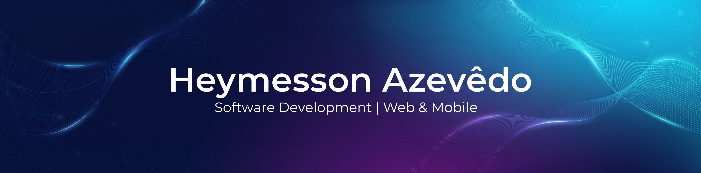

<!-- ================= HEADER ================= -->
<div align="center">
  

  <br/><br/>

  

  <br/>

  <a href="https://github.com/Heymesson-AZ">
    
  </a>
  <a href="https://www.linkedin.com/in/heymesson-dev">
    
  </a>
  
</div>

---

<!-- ================= ABOUT ================= -->
## 👨‍💻 Sobre mim

```javascript
    const heymesson = {
        nome: "Heymesson Azevêdo",
        area: "Desenvolvimento de Software",
        formacao: "Estudante de Tecnologia",
    
        interesses: [
            "Desenvolvimento Web",
            "Desenvolvimento Mobile",
            "Cloud Computing"
        ],
    
        tecnologias: [
            "PHP", "Laravel", "JavaScript",
            "React", "React Native", "Python",
            "Node.js", "MySQL"
        ],
    
        infraestrutura: "Oracle Cloud Infrastructure",
        metodologia: "Scrum",
        status: "Open to Work"
    };
```

Sou estudante de tecnologia, apaixonado por programação, desenvolvimento de software e inovação.

Tenho interesse na criação de aplicações Web e Mobile, buscando transformar ideias em soluções funcionais, organizadas e eficientes.

Gosto de aprender novas tecnologias, desenvolver projetos práticos e aplicar meus conhecimentos na construção de sistemas reais.

🚀 Sempre aprendendo, desenvolvendo e evoluindo!

<!-- ================================================== -->

<!-- TECH STACK -->

<!-- ================================================== -->

⚡ Tech Stack

<div align="center">

💻 Linguagens de Programação


<br/><br/>

⚙️ Frameworks e Bibliotecas


<br/><br/>

📱 Desenvolvimento Mobile


<br/><br/>

🗄️ Banco de Dados


<br/><br/>

☁️ Cloud e Ferramentas


<br/><br/>


</div>

<!-- ================================================== -->

<!-- PROJECTS -->

<!-- ================================================== -->

🚀 Projetos em Destaque

Projetos desenvolvidos para aplicar conhecimentos, explorar tecnologias e construir soluções práticas.

📚 01. Sistema Web de Livros


Sistema Web desenvolvido com Laravel, Blade e JavaScript, hospedado na Oracle Cloud Infrastructure utilizando recursos da camada gratuita (Free Tier).

Destaques:

Desenvolvimento Web com Laravel.

Construção de interfaces com Blade.

Hospedagem em infraestrutura de nuvem.

Experiência prática com implantação de aplicações.


🛒 02. App Lista de Compras


Aplicativo Mobile desenvolvido com React Native e Expo, utilizando AsyncStorage para armazenamento local e persistência dos dados.

Destaques:

Desenvolvimento de aplicações Mobile.

Gerenciamento de listas de compras.

Persistência de dados local.

Utilização do ecossistema Expo.


🏢 03. SG3S — Sistema de Gerenciamento


Sistema Web desenvolvido individualmente, do zero, como Projeto Integrador (PI) do curso técnico em Análise e Desenvolvimento de Sistemas.

Destaques:

Arquitetura MVC (Model-View-Controller).

Desenvolvimento individual, desde a concepção até a implementação.

Gerenciamento de tecidos, usuários, fornecedores e clientes.

Módulos de vendas e relatórios.

Operações CRUD nos módulos de gerenciamento.

Interface estilizada com Bootstrap.


<div align="center">

<a href="https://github.com/Heymesson-AZ?tab=repositories">

</a>

</div>

<!-- ================================================== -->

<!-- GITHUB ANALYTICS -->

<!-- ================================================== -->

📊 GitHub Analytics

<div align="center">


<br/><br/>


</div>

<!-- ================================================== -->

<!-- ACTIVITY GRAPH -->

<!-- ================================================== -->

📈 Histórico de Contribuições

<div align="center">


</div>

<!-- ================================================== -->

<!-- CURRENTLY LEARNING -->

<!-- ================================================== -->

🎯 Atualmente

💻 Aprimorando meus conhecimentos em Desenvolvimento Web com PHP e Laravel.

📱 Explorando Desenvolvimento Mobile com React Native e Expo.

🗄️ Trabalhando com bancos de dados e persistência de informações.

☁️ Explorando infraestrutura em nuvem e hospedagem de aplicações.

🚀 Desenvolvendo projetos práticos e aprimorando minhas habilidades.

<!-- ================================================== -->

<!-- OPEN TO WORK -->

<!-- ================================================== -->

💼 Open to Work | Aberto a Oportunidades

Estou aberto a oportunidades profissionais e novos desafios na área de tecnologia.

Áreas de interesse:

💻 Estágio em Desenvolvimento de Software.

🌐 Desenvolvedor Web Júnior.

📱 Desenvolvedor Mobile Júnior.

🚀 Desenvolvimento Full Stack.

🤝 Projetos colaborativos.

Tenho disposição para aprender, trabalhar em equipe, compartilhar conhecimentos e contribuir para o desenvolvimento de soluções inovadoras.

<div align="center">

<a href="https://www.linkedin.com/in/heymesson-dev">

</a>

</div>

<!-- ================================================== -->

<!-- FOOTER -->

<!-- ================================================== -->

<div align="center">

🤝 Vamos construir algo incrível juntos?

Code. Learn. Build. Repeat. 🚀

<br/>


</div>
  <p><strong>Code. Learn. Build. Repeat.</strong> 🚀</p>
</div>
